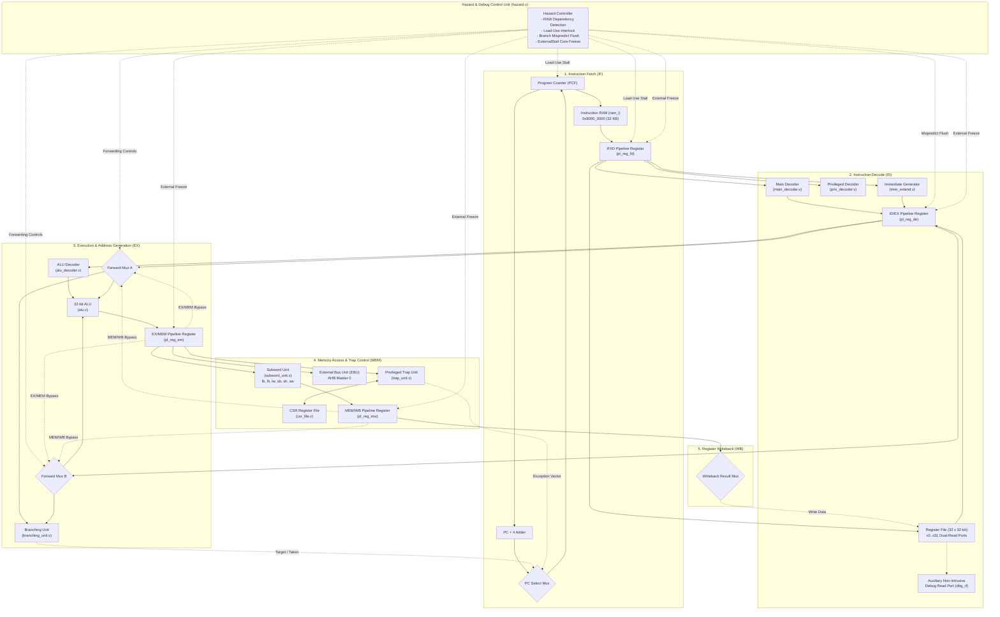

# 1TOPS RISC-V System-on-Chip (1TOPS SoC)

A high-performance, synthesizable 5-stage pipelined RV32I RISC-V System-on-Chip featuring an AMBA 3 AHB-Lite and APB bus fabric, an integrated dual-protocol in-hardware debugger (UART + FT1248), a non-intrusive post-mortem core inspection slave, comprehensive uncore peripherals with System Control Block and Dual-Mode Bootloader (Internal ROM & SPI Flash), and a dedicated 16 MB accelerator IP socket integrated as part of uncore.

---

## 1. System Architecture & Circuitry Block Diagram

The SoC integrates the pipelined processor core, the hardware debugger subsystem, the bus arbiter, the uncore peripherals (including the accelerator IP socket), and the system control/boot block.

```text
========================================================================================================================
                                             1TOPS SoC COMPLETE CIRCUITRY ARCHITECTURE
========================================================================================================================

  +------------------------------------------------------------------------------------------------------------------+
  |                                            EXTERNAL PHYSICAL PINS & I/O                                          |
  |  clk, reset_btn, boot_mode, dbg_sel, uart_rx, uart_tx, ft1248_clk, ft1248_ss_n, ft1248_miso, ft1248_miosio,       |
  |  UARTSin, UARTSout, SPIIn, SPIOut, SPICS[3:0], SPICLK, GPIOIN[31:0], GPIOOUT[31:0], GPIOEN[31:0], core_halted_led  |
  +------------------------------------------------------------------------------------------------------------------+
          |           |           |           |           |           |           |           |
          |           +-----------+-----------+           |           |           |           |
          |           |   DUAL-PROTOCOL DEBUGGER PINS     |           |           |           |
          |           |   (dbg_sel, uart_rx/tx, FT1248)   |           |           |           |
          |           +-----------------------------------+           |           |           |
          |                             |                             |           |           |
          v                             v                             |           |           |
  +------------------+        +-----------------------------------+   |           |           |
  |  RESET & CLOCK   |        |   DUAL-PROTOCOL HARDWARE DEBUGGER |   |           |           |
  |  SYNCHRONIZER    |        |   - Dedicated Debug UART (115.2k) |   |           |           |
  |  - Active-Low    |        |   - FT1248 Synchronous Bus Engine |   |           |           |
  |    HRESETn       |        |   - ASCII Debug Protocol (ADP)    |   |           |           |
  |  - Synchronized  |        |     Auto-Boot Prompt (']') Engine |   |           |           |
  |    core_HRESETn  |        |   - In-Flight Dynamic Dividers    |   |           |           |
  +------------------+        +-----------------------------------+   |           |           |
          |                     |                   |                 |           |           |
          |          core_halt  |    dbg_core_step  |  Debugger AHB   |           |           |
          |          core_reset |    dbg_step_mode  |  Master (M1)    |           |           |
          |                     v                   v                 |           |           |
          |           +--------------------+  +-------------------+   |           |           |
          |           | CORE STEP          |  | dbg_HADDR, HWDATA,|   |           |           |
          |           | CONTROLLER FSM     |  | HWRITE, HTRANS,   |   |           |           |
          |           | - Single-Instr Step|  | HSIZE, dbg_HWSTRB |   |           |           |
          |           | - Clock-Cycle Step |  +---------+---------+   |           |           |
          |           | - Auto-Halt Trap   |            |             |           |           |
          |           +---------+----------+            |             |           |           |
          |                     |                       |             |           |           |
          |   core_stall_       |                       |             |           |           |
          |   effective         |                       |             |           |           |
          v                     v                       |             |           |           |
  +---------------------------------------------------+ |             |           |           |
  |              5-STAGE PIPELINED RV32I CORE         | |             |           |           |
  |                                                   | |             |           |           |
  |  [IF Stage]  PCF, Adder (+4), PC Mux, pl_reg_fd   | |             |           |           |
  |      |                                            | |             |           |           |
  |  [ID Stage]  Main Decoder, Controller, pl_reg_de  | |             |           |           |
  |              Imm Extend, RegFile (32x32, 2R/1W)   | |             |           |           |
  |              + Non-Intrusive Debug Port (dbg_rf)  | |             |           |           |
  |      |                                            | |             |           |           |
  |  [EX Stage]  ALU, ALU Decoder, Branch Unit,       | |             |           |           |
  |              Operand Forwarding Muxes, pl_reg_em  | |             |           |           |
  |      |                                            | |             |           |           |
  |  [MEM Stage] Subword Unit (lb/lh/lw/sb/sh/sw),    | |             |           |           |
  |              Trap Unit, CSR File, pl_reg_mw       | |             |           |           |
  |      |                                            | |             |           |           |
  |  [WB Stage]  Writeback Mux -> RegFile Write Port  | |             |           |           |
  |      |                                            | |             |           |           |
  |  [Hazard]    Hazard Detection, RAW Forwarding,    | |             |           |           |
  |              Load-Use Stall, ExternalStall Freeze | |             |           |           |
  |      |                                            | |             |           |           |
  |  Core AHB Master (M0): core_HADDR, core_HWDATA,   | |             |           |           |
  |                        core_HWRITE, core_HTRANS   | |             |           |           |
  +-------------------------+-------------------------+ |             |           |           |
                            |                           |             |           |           |
                            | Master 0 (CPU)            | Master 1    |           |           |
                            v                           v (Debugger)  |           |           |
                  +-------------------------------------------+       |           |           |
                  |     2-to-1 AHB-LITE BUS ARBITER / MUX     |       |           |           |
                  |     (source/debugger/ahb_mux.sv)          |       |           |           |
                  |  - Default: Master 0 (CPU Core)           |       |           |           |
                  |  - Priority: Master 1 (Debugger) when     |       |           |           |
                  |    Core is Halted or Single-Stepping      |       |           |           |
                  |  - Full HWSTRB Byte-Strobe Multiplexing   |       |           |           |
                  +---------------------+---------------------+       |           |           |
                                        |                             |           |           |
                                        | Downstream AHB-Lite Bus     |           |           |
                                        | (HADDR, HWDATA, HWSTRB,     |           |           |
                                        |  HWRITE, HSIZE, HTRANS)     |           |           |
           +----------------------------+-----------------------------+           |           |
           |                            |                             |           |           |
           v                            v                             v           |           |
  +--------------------+      +--------------------+      +---------------------+ |           |
  | CORE POST-MORTEM   |      | ACCELERATOR IP     |      | UNCORE SUBSYSTEM    | |           |
  | DEBUG AHB SLAVE    |      | SOCKET (UNCORE)    |      | (source/uncore/     | |           |
  | (0x0B00_0000)      |      | (0x3000_0000)      |      |  uncore.sv)         | |           |
  | - GPRs x0 - x31    |      | - 16 MB Aperture   |      | - AHB Address Dec   | |           |
  | - Pipeline PCs     |      | - Hardware Multi-  |      | - Delay Phase Regs  | |           |
  |   (PCF..PCW)       |      |   plier / Accel IP |      | - Interrupt Router  | |           |
  | - CSRs (mstatus,   |      | - Registers:       |      | - System Control    | |           |
  |   mcause, mepc...) |      |   OPA, OPB,        |      |   (sysctrl_apb.sv)  | |           |
  | - 16-Entry Trace   |      |   RESULT, PRINT    |      +----------+----------+ |           |
  | - Sticky Traps     |      |   (Part of Uncore) |                 |            |           |
  | - Clock Dividers   |      +--------------------+                 |            |           |
  +--------------------+                                             |            |           |
                                                                     |            |           |
       +-------------------------+-----------------------------------+            |           |
       |                         |                       |                        |           |
       v                         v                       v                        |           |
  +---------------+       +---------------+       +---------------+               |           |
  |  Boot ROM     |       |  Instr RAM    |       |  Data RAM     |               |           |
  |  (rom_ahb)    |       |  (ram_ahb)    |       |  (ram_ahb)    |               |           |
  | 0x0000_1000 - |       | 0x8000_0000 - |       | 0x8001_0000 - |               |           |
  | 0x0000_1FFF   |       | 0x8000_7FFF   |       | 0x8001_7FFF   |               |           |
  | (4 KB)        |       | (32 KB Alloc, |       | (32 KB Alloc, |               |           |
  |               |       |  64 KB Apetr) |       |  64 KB Apetr) |               |           |
  +---------------+       +---------------+       +---------------+               |           |
                                                                  |               |           |
                                              +-------------------+               |           |
                                              | AHB-to-APB Bridge                 |           |
                                              | (ahbapbbridge.sv)                 |           |
                                              +---------+-------------------------+           |
                                                        |                                     |
                                                        | APB Peripherals Bus (PCLK, PADDR,   |
                                                        | PWDATA, PRDATA, PWRITE, PSEL)       |
                   +-------------------+----------------+-------------------+                 |
                   |                   |                                    |                 |
                   v                   v                                    v                 v
         +-------------------+ +-------------------+              +-------------------+ +-------------------+
         | CLINT TIMER & SWI | | PLIC INTERRUPTS   |              | 16550 APPL. UART  | | SPI MASTER & FIFO |
         | (clint_apb.sv)    | | (plic_apb.sv)     |              | (uart_apb.sv +    | | (spi_apb.sv +     |
         | 0x0200_0000       | | 0x0C00_0000       |              |  uartPC16550D.sv) | |  spi_fifo.sv)     |
         | - msip: 0x02000000| | - 64 MB Aperture  |              | 0x1000_0000       | | 0x1004_0000       |
         | - mtime:0x0200BFF8| | - Prioritized     |              | - 16550 reg model | | - SiFive FU540    |
         | - mtimecmp        | |   Gateway         |              | - 16-Byte FIFOs   | |   Compatible      |
         +---------+---------+ +---------+---------+              | - PMOD JA pins    | | - TX/RX FIFOs     |
                   | MTimerInt           | MExtInt_uncore         +---------+---------+ +---------+---------+
                   | MSwInt              |                                  |                     |
                   +----------+----------+                                  v                     v
                              |                                         UARTSin /             SPIIn / SPIOut,
                              v                                         UARTSout              SPICS, SPICLK
                   Core Interrupt Lines
========================================================================================================================
```

---

## 2. Processor Pipeline & Hazard Resolution Flowchart

The processor core implements a classic 5-stage RISC-V pipeline with full data forwarding, branch misprediction flushing, load-use stalling, and debugger hardware freezing:



---

## 3. Complete System Memory Map

The SoC address map allocates dedicated spaces for on-chip memories, debug apertures, peripherals, and accelerators:

| Start Address | End Address | Allocated Size | Aperture | Bus | Module / Peripheral | Function / Description |
|:---:|:---:|:---:|:---:|:---:|:---|:---|
| `0x0000_1000` | `0x0000_1FFF` | 4 KB | 4 KB | AHB | `rom_ahb.sv` | On-chip Boot ROM (Reset bootloader) |
| `0x0200_0000` | `0x0200_FFFF` | 64 KB | 64 KB | APB | `clint_apb.sv` | Core Local Interruptor: `msip` (0x0000), `mtimecmp` (0x4000), `mtime` (0xBFF8) |
| `0x0B00_0000` | `0x0B00_0FFF` | 4 KB | 4 KB | AHB | `core_debug_ahb.v` | Core Post-Mortem Debug Slave: GPRs `x0`–`x31`, PCs (`PCF`..`PCW`), CSRs, Trace Buffer |
| `0x0C00_0000` | `0x0FFF_FFFF` | 64 MB | 64 MB | APB | `plic_apb.sv` | Platform-Level Interrupt Controller: 4 sources, 3-bit priorities, threshold, claim register (no gateway; writes to claim are ignored, an interrupt clears when its source drops) |
| `0x1000_0000` | `0x1000_0FFF` | 8 B | 4 KB | APB | `uart_apb.sv` | Uncore application UART. 16550 register layout; the SoC builds the register-only model (`USE_REAL_UART = 0`): THR writes print in simulation, no serial TX/RX on hardware. The full `uartPC16550D.sv` core is present but not selected |
| `0x1004_0000` | `0x1004_0FFF` | 4 KB | 4 KB | APB | `spi_apb.sv` | SiFive FU540-compatible SPI Master controller with 8-byte TX/RX FIFOs |
| `0x1006_0000` | `0x1006_0FFF` | 56 B | 4 KB | APB | `gpio_apb.sv` | 32-bit GPIO: input/output enables, output value, rise/fall (sticky) and high/low (live) interrupts. No polarity-inversion register |
| `0x1008_0000` | `0x1008_0FFF` | 28 B | 4 KB | APB | `sysctrl_apb.sv` | System Control Block: soft core reset, reset-cause flags, strap sampling, ROM remap, scratchpad, chip ID. Reset-vector and clock-gating registers exist but are not connected |
| `0x3000_0000` | `0x30FF_FFFF` | 16 MB | 16 MB | AHB | `multiplier_ahb.v` | Accelerator IP Socket (Part of Uncore) |
| `0x8000_0000` | `0x8000_7FFF` | **32 KB** | 64 KB | AHB | `ram_ahb.sv` (`ram_i`) | **Instruction RAM (IRAM)**: Executable code space (Reset Vector = `0x8000_0000`) |
| `0x8001_0000` | `0x8001_7FFF` | **32 KB** | 64 KB | AHB | `ram_ahb.sv` (`ram_d`) | **Data RAM (DRAM)**: Variables, heap, stack (Stack Top = `0x8001_8000`) |

> [!IMPORTANT]
> **Data Memory Aperture Relocation**:
> The Data RAM (`ram_d`) base address is relocated to **`0x8001_0000`** (previously `0x8000_2000`). Both Instruction RAM (`ram_i`) and Data RAM (`ram_d`) are allocated with **at least 32 KB** of dedicated on-chip memory each (8,192 32-bit words), providing ample capacity for deep instruction loops and bare-metal runtime heaps.

---

## 4. Source Code Hierarchy & Directory Structure

All synthesizable RTL, testbenches, and verification harnesses are organized under the `source/` tree:

```
source/
├── components/                          # Pipelined CPU Core Building Blocks
│   ├── adder.v                          # 32-bit Adder (PC incrementer and branch calculator)
│   ├── ahbinterface.v                   # Core AHB Master protocol translation unit
│   ├── alu.v                            # 32-bit Arithmetic Logic Unit (ADD, SUB, SLL, SLT, XOR...)
│   ├── alu_decoder.v                    # ALU opcode decoder (funct3, funct7, ALUOp)
│   ├── branching_unit.v                 # Branch condition evaluator (BEQ, BNE, BLT, BGE...)
│   ├── controller.v                     # Main pipeline control coordination logic
│   ├── csr_file.v                       # Privileged CSR registers & 64-bit cycle counters
│   ├── datapath.v                       # 5-Stage RV32I processor datapath
│   ├── ebu.v                            # External Bus Unit (interfacing memory stage to bus)
│   ├── hazard.v                         # RAW data forwarding, load-use stall, ExternalStall
│   ├── imm_extend.v                     # Sign-extension immediate generator (I, S, B, U, J)
│   ├── main_decoder.v                   # 7-bit RISC-V opcode decoder
│   ├── mux2.v, mux3.v, mux4.v, mux5.v   # Parametric multiplexers
│   ├── pl_reg_fd.v                      # Fetch-to-Decode (IF/ID) pipeline register
│   ├── pl_reg_de.v                      # Decode-to-Execute (ID/EX) pipeline register
│   ├── pl_reg_em.v                      # Execute-to-Memory (EX/MEM) pipeline register
│   ├── pl_reg_mw.v                      # Memory-to-Writeback (MEM/WB) pipeline register
│   ├── priv_decoder.v                   # Privileged instruction decoder (CSR, MRET, WFI, ECALL)
│   ├── reg_file.v                       # 32x32 RegFile with auxiliary debug read port (dbg_rf)
│   ├── reset_ff.v                       # Reset synchronizer flip-flop
│   ├── subword_unit.v                   # Subword load/store byte extraction & sign extension
│   └── trap_unit.v                      # Synchronous exception & asynchronous interrupt router
├── main/                                # CPU & SoC Top-Level Wrappers
│   ├── riscv_cpu.v                      # Top-level RV32I CPU core module
│   ├── riscv_top.v                      # Standalone core wrapper
│   ├── ahb_ram.v                        # Configurable AHB-Lite synchronous memory model
│   ├── pipelined/
│   │   └── riscv_pipelined.v            # Lightweight core variant
│   └── soc/
│       ├── riscv_soc_ahb.v              # Master SoC top-level integrating Core, Debugger, Uncore
│       └── multiplier_ahb.v             # Accelerator IP socket slave (0x3000_0000, part of uncore)
├── uncore/                              # Uncore Subsystem & Peripherals
│   ├── uncore.sv                        # Top-level uncore with address decoding & delay registers
│   ├── ram_ahb.sv                       # Synthesizable BRAM-inferring on-chip SRAM (ram_i, ram_d)
│   ├── rom_ahb.sv                       # On-chip Boot ROM (0x0000_1000)
│   ├── bootrom.mem                      # Default precompiled dual-mode Boot ROM hex image
│   ├── sysctrl_apb.sv                   # System Control Block (Reset, Straps, Remap, Clocks)
│   ├── ahbapbbridge.sv                  # AHB-to-APB protocol translation bridge
│   ├── clint_apb.sv                     # Core Local Interruptor (mtime, mtimecmp, msip)
│   ├── plic_apb.sv                      # Platform-Level Interrupt Controller
│   ├── uart_apb.sv                      # APB wrapper for 16550 UART
│   ├── uartPC16550D.sv                  # Synthesizable TI PC16550D UART core with FIFOs
│   ├── spi_apb.sv                       # APB wrapper for SPI Master
│   ├── spi_controller.sv                # SPI serialization controller & clock generator
│   ├── spi_fifo.sv                      # SPI 8-entry transmit/receive FIFOs
│   └── gpio_apb.sv                      # 32-bit GPIO with edge and level interrupts
├── debugger/                            # In-Hardware Debugger Subsystem
│   ├── riscv_debugger_top.sv            # Dual-protocol hardware debugger top wrapper
│   ├── ahb_mux.sv                       # 2-to-1 AHB arbiter granting priority to debugger
│   ├── core_step_controller.sv          # Hardware single-step (instr & cycle) FSM controller
│   ├── core_debug_ahb.v                 # Post-mortem AHB slave at 0x0B00_0000 (GPRs, PCs, trace)
│   ├── socdebug_uart.v                  # Dedicated 115200-baud debugger UART transceiver
│   ├── socdebug_ft1248_control.v        # High-speed FT1248 synchronous 1-bit bus engine
│   ├── socdebug_adp_control.v           # ASCII Debug Protocol (ADP) command parser & prompt
│   ├── socdebug_ahb.v                   # Debugger AHB Master bus transactor
│   ├── accelerator_debug_def.vh         # Debug register definitions
│   ├── basys3_soc.xdc                   # Pin constraints for Digilent Basys 3 FPGA
│   ├── sw/
│   │   └── dbg_cli.py                   # Python CLI utility for host PC debugger interaction
│   └── tb/                              # Comprehensive testbenches for debugger subsystem
├── final_tests/                         # 7-Subsystem Verification Suites
│   ├── 01_core_modules/                 # Subsystem 1: Core Datapath & ALU operations
│   ├── 02_pipeline_hazard_stress/       # Subsystem 2: Hazard forwarding, stalls & SVA assertions
│   ├── 03_cpu_core_arch/                # Subsystem 3: CPU architectural compliance vs Spike ISS
│   ├── 04_bus_fabric/                   # Subsystem 4: AMBA AHB/APB bus fabric CRV verification
│   ├── 05_peripherals/                  # Subsystem 5: Peripherals (CLINT/PLIC/UART/SPI/GPIO/Accel)
│   ├── 06_debugger_subsystem/           # Subsystem 6: Dual-protocol debugger & stepping tests
│   └── 07_soc_system_benchmarks/        # Subsystem 7: Bare-metal C benchmarks on full SoC
├── standard_core_tests/                 # Industry-Standard Benchmark Suites
│   ├── 01_riscv_arch_test/              # Official RISC-V Architectural Test Suite
│   ├── 02_berkeley_riscv_tests/         # Berkeley RV32UI verification tests
│   ├── 03_eembc_coremark/               # EEMBC CoreMark embedded benchmark
│   ├── 04_dhrystone/                    # Dhrystone 2.1 benchmark
│   ├── 05_embench_iot/                  # Embench™ IoT embedded benchmark suite
│   └── 06_google_riscv_dv_torture/      # Google RISCV-DV torture tests
├── testbench/                           # Top-level Verilator & Questa testbenches
├── run.sh                               # Automated regression runner script
└── README.md                            # This comprehensive documentation
```

---

## 5. Circuitry & Subsystem Deep Dive

### A. Dual-Master AHB-Lite Bus Arbiter (`ahb_mux.sv`)
The system incorporates two independent bus masters:
1. **Master 0 (CPU Core)**: Drives bus transactions during normal program execution.
2. **Master 1 (Hardware Debugger)**: Drives bus transactions during interactive debugging, binary uploads, memory fills, and register queries.

`ahb_mux.sv` implements a glitch-free 2-to-1 bus arbiter:
- **Priority Rules**: Whenever the CPU core is halted (`dbg_core_halt_status = 1`) or stepping (`dbg_step_busy = 1`), Master 1 is granted immediate priority. When the core is actively running, Master 0 controls the bus.
- **Data Phase Tracking**: The grant decision is registered into `grant_data` to ensure that data-phase write data (`HWDATA`) and byte strobes (`HWSTRB`) align perfectly with their corresponding address phase.
- **Response Multiplexing**: Return data (`HRDATA`), `HREADY`, and `HRESP` are routed back exclusively to the currently active master.

### B. Core Post-Mortem Debugging AHB Slave (`core_debug_ahb.v` at `0x0B00_0000`)
Rather than relying on invasive JTAG TAP state machines, the SoC integrates a dedicated AHB slave mapped at base `0x0B00_0000`:
- **GPR Table (`0x0B00_0000` - `0x0B00_007C`)**: Connects directly to the auxiliary read port (`dbg_rf_raddr`, `dbg_rf_rdata`) of `reg_file.v`, enabling non-intrusive instant readout of all 32 general-purpose registers `x0` through `x31`.
- **Pipeline Stage PCs (`0x0B00_0080` - `0x0B00_0090`)**: Directly latches the active program counter in each stage: `PCF` (Fetch), `PCD` (Decode), `PCE` (Execute), `PCM` (Memory), and `PCW` (Writeback).
- **16-Entry Micro-Trace FIFO**: Automatically records the last 16 retired instruction addresses, providing a complete execution trace immediately preceding any crash or trap.
- **Sticky Trap Registers**: Latches `mcause` and `mtval` when an unexpected exception or interrupt occurs.
- **Auto-Halt on Trap**: Asserts `auto_halt_trap_o` to automatically freeze the CPU pipeline upon encountering unhandled exceptions.
- **Dynamic Clock Divider Registers**:
  * `0x0B00_00E0`: 16-bit UART baud rate divider configuration register.
  * `0x0B00_00E4`: 8-bit FT1248 clock divider configuration register.

### C. Core Step Controller (`core_step_controller.sv`)
Provides precision stepping capabilities for microarchitectural debugging:
- **Instruction Stepping (`C 0204` / `C 0104`)**: Deasserts `core_stall_o` for exactly enough clock cycles to allow the pipeline to retire exactly one instruction (`InstrRetired = 1`), then automatically asserts `core_stall_o` to freeze the core again.
- **Clock-Cycle Stepping (`C 020c` / `C 010c`)**: Releases `core_stall_o` for exactly one clock cycle, allowing state transitions to be inspected clock tick by clock tick.
- **Watchdog Protection**: If an instruction step does not retire within 65,536 clock cycles (e.g., due to an infinite bus stall or wait-for-interrupt), the controller auto-aborts and sets a timeout flag.

### D. Uncore Subsystem & On-Chip Memories (`uncore.sv`)
- **Memory Allocation**:
  * **Instruction RAM (`ram_i`)**: Base `0x8000_0000`, 32 KB allocated (range `0x8000_0000` - `0x8000_7FFF`).
  * **Data RAM (`ram_d`)**: Base `0x8001_0000`, 32 KB allocated (range `0x8001_0000` - `0x8001_7FFF`).
- **Native Block RAM Inference**: `ram_ahb.sv` implements 4 independent byte-wide memory arrays (`mem0`..`mem3`), guaranteeing 100% native Block RAM inference (`RAMB36E1` on Xilinx 7-series, `M9K` on Intel/Altera) without consuming tens of thousands of logic LUTs.
- **Subword-Accurate HWSTRB Byte Decoding**: Byte (`sb`), halfword (`sh`), and word (`sw`) stores generate individual byte lane strobes (`HWSTRB[3:0]`), preventing corrupted adjacent bytes during subword memory stores or binary byte uploads (`U`).

### E. Accelerator IP Socket (Part of Uncore - `multiplier_ahb.v` at `0x3000_0000`)
The SoC provides a dedicated accelerator IP socket integrated as part of the uncore subsystem, mapped to `0x3000_0000`:
- `0x3000_0000`: Operand A Register (`OPA` - Write)
- `0x3000_0004`: Operand B Register (`OPB` - Write)
- `0x3000_0008`: Product / Accelerator Result Register (`RESULT` - Read)
- `0x3000_000C`: Print / Debug Character Register (`PRINT` - Write)
- `0x3000_1000 - 0x30FF_FFFF`: Extended accelerator buffer aperture.

### F. System Control Block & Dual-Mode Bootloader (`sysctrl_apb.sv` & `rom_ahb.sv`)
- **System Control Block (`sysctrl_apb.sv`) at Base `0x1008_0000` (APB Slot 5)**:
  * 2-stage reset synchronizer and 16-cycle hold counter to eliminate metastability.
  * Reset strap sampler: samples external `boot_mode` pin upon reset release and latches into read-only `REG_BOOT_STATUS` (`0x1008_0008`).
  * Reset vector register (`REG_RESET_VEC` at `0x1008_0004`, default `0x0000_1000`). **Not connected to the core**: the reset PC is fixed by the `RESET_PC` / `DBG_RESET_PC` parameters, so writing it has no effect.
  * Dynamic ROM remap register (`REG_REMAP_CTRL` at `0x1008_000C`) aliasing `0x0000_0000` to Instruction RAM.
  * Peripheral clock gating mask register (`REG_CLK_CTRL` at `0x1008_0010`). **Not connected**: no clock gates exist.
  * Soft reset control (`REG_RESET_CTRL` at `0x1008_0000`): bit 0 is an active-low run bit (1 = run, 0 = hold the core in reset) and does not self-clear. Write `0x12` then `0x13` for a soft core reset. Bit 1 (peripheral reset) is not connected.
  * General-purpose firmware / debugger diagnostics scratchpad (`REG_SCRATCHPAD` at `0x1008_0014`).
- **Synthesizable Boot ROM (`rom_ahb.sv`) at Base `0x0000_1000`**. The table currently holds the legacy dual-mode ROM described below. The new SPI "BOOT"-stream loader (`software/bootrom_int`, `software/common/loader.S`) replaces it once generated with `make -C software rom`:
  * **Mode 0 (`boot_mode = 0`)**: Executes internal ROM self-test and reaches `main()` directly within ROM.
  * **Mode 1 (`boot_mode = 1`)**: Programs SPI controller (`0x1004_0000`), issues READ command `0x03` to external SPI Flash, streams instructions into IMEM (`0x8000_0000`), and executes `jr 0x8000_0000`.

### G. Interrupt & Exception Handling (`trap_unit.v` & `csr_file.v`)
Traps are taken precisely in the Memory stage. `trap_unit.v` picks the highest-priority pending trap and computes the target PC; `csr_file.v` holds `mtvec`, `mcause`, `mepc`, `mtval`, `mstatus`, `mie` and `mip`.

**Interrupt vector table**

| Trap | Code | `mcause` | Source | Priority | Target PC (vectored mode) |
| :--- | :---: | :--- | :--- | :---: | :--- |
| Machine external interrupt (MEI) | 11 | `0x8000_000B` | PLIC (UART = src 1, GPIO = src 2, SPI = src 3) or `MExtInt` pin | 1 (highest) | `BASE + 0x2C` |
| Machine software interrupt (MSI) | 3 | `0x8000_0003` | CLINT `msip` | 2 | `BASE + 0x0C` |
| Machine timer interrupt (MTI) | 7 | `0x8000_0007` | CLINT `mtime >= mtimecmp` | 3 | `BASE + 0x1C` |
| Instruction address misaligned | 0 | `0x0000_0000` | Tied off (never raised, bug N9) | 4 | `BASE` (mtval = PC) |
| Illegal instruction | 2 | `0x0000_0002` | Bad SYSTEM encoding only (bug N2) | 5 | `BASE` (mtval = instruction) |
| Breakpoint (`ebreak`) | 3 | `0x0000_0003` | `ebreak` | 6 | `BASE` (mtval = PC) |
| Environment call (`ecall`) | 11 | `0x0000_000B` | `ecall` | 7 (lowest) | `BASE` (mtval = 0) |

- **Enable:** an interrupt is taken only when `mstatus.MIE = 1` and its `mie` bit is set (MSIE = bit 3, MTIE = bit 7, MEIE = bit 11). Interrupts win over exceptions.
- **Direct mode** (`mtvec[1:0] = 00`): every trap jumps to `BASE = {mtvec[31:2], 2'b00}`.
- **Vectored mode** (`mtvec[1:0] = 01`): interrupts jump to `BASE + 4 x cause`; exceptions still go to `BASE`. Each slot is 4 bytes, so it normally holds one `j handler`.
- **On trap entry:** `mepc <- PCM`, `mcause`/`mtval` written, `MPIE <- MIE`, `MIE <- 0`, `MPP <- 11`, younger instructions flushed.
- **`mret`:** `MIE <- MPIE`, `MPIE <- 1`, PC <- `mepc`.
- **Not implemented:** load/store misaligned and access faults (causes 1, 4-7). A bus error does not trap.

---

## 6. ASCII Debug Protocol (ADP) Command Reference

When interacting over the dedicated Debugger UART (115200 Baud, 8-N-1) or FT1248 bus, the hardware auto-boots directly into the ASCII Debug Protocol prompt (`]`):

| Command | Arguments | Description | Example |
|:---:|:---|:---|:---|
| **`A`** | `<hex_addr>` | Set 32-bit AHB address pointer | `A 80010000` (point to Data RAM) |
| **`R`** | `[count]` | Read from the address pointer and auto-increment. Plain `R` = 1 word. With a count, the number of hex digits sets the size: 1-2 = bytes, 3-4 = halfwords, 5-8 = words | `R` (1 word) or `R 00000020` (32 words); `R 20` reads 32 **bytes** |
| **`W`** | `<hex_data>` | Write to the address pointer and auto-increment; size from digit count (8 digits = word) | `W deadbeef` |
| **`V`** | `<hex_data>` | Set reference data value for Fill/Poll | `V 00000000` |
| **`F`** | `<hex_count>`| Fill `<count>` consecutive items with the value in `V` (item size follows the digit count used in `V`) | `V 00000000`, `F 200` (zero 512 words) |
| **`U`** | `<hex_count>`| Stream `<count>` raw binary bytes sequentially | `U 4c` (stream 76 raw bytes) |
| **`C 0202`**| — | **Halt CPU Core** (pipeline frozen via `ExternalStall`) | `C 0202` |
| **`C 0102`**| — | **Resume CPU Core** (pipeline execution resumes) | `C 0102` |
| **`C 0204`**| — | **Single-Step 1 Instruction** (advance 1 retired instr)| `C 0204` followed by `C 0104` |
| **`C 020c`**| — | **Single-Step 1 Clock Cycle** (advance 1 clock tick) | `C 020c` followed by `C 010c` |
| **`C 0201`**| — | Assert CPU Core Reset (hold PC at `0x8000_0000`) | `C 0201` |
| **`C 0101`**| — | Deassert CPU Core Reset | `C 0101` |
| **`C`** | — | Query status. Reply `C 0x<GPI8><GPO8><param16>`; GPI8 bits: 0 halted, 1 step busy, 2 step done, 3 trap latched, 4 illegal instr, 5 misalign, 6 mem fault, 7 trap active | `C` -> replies `C 0x01000000` |
| **`B`** | `[hex16]` | Query or set 16-bit UART baud rate divider | `B` or `B 00d9` (230,400 baud) |
| **`D`** | `[hex8]` | Query or set 8-bit FT1248 clock divider | `D` or `D 08` |
| **`M`** | `<hex_mask>` | Set the bit mask used by `P` | `M 00000001` |
| **`P`** | `[timeout]` | Word-read the pointer address until `(data & M) == V` or `timeout` reads | `P 000003e8` |
| **`X`** | — | Leave command mode (`ESC` re-enters). Note: the debugger STDIO stream is tied off in this SoC, so passthrough mode and the `S` command carry no data | `X` |

---

## 7. Interactive FPGA Demo Walkthrough (Basys 3)

The hardware debugger allows uploading and verifying bare-metal programs without requiring an external JTAG pod:

### Factorial Demo Walkthrough (`software/factorial.S`)
1. **Connect HTerm** to the Basys 3 on-board micro-USB COM port: 115200 Baud, 8 Data Bits, 1 Stop Bit, No Parity, Send on Enter = `CR`.
2. **Boot / Reset**: Press center pushbutton `btnC` (or power cycle). The terminal immediately displays:
   ```text
    0x50c1ab04
   ]
   ```
   `led_rx_detect` (LED 15) turns solidly ON.
3. **Halt CPU Pipeline**:
   ```text
   C 0202
   ```
   `led_core_halted` (LED 0) illuminates.
4. **Clear Instruction Memory**:
   ```text
   A 80000000
   V 00000000
   F 200
   ```
5. **Set Input Argument ($n = 5$) in Data RAM at `0x80010000`**:
   ```text
   A 80010000
   W 00000005
   W 00000000
   ```
6. **Upload Program Binary (`factorial.bin`)**:
   ```text
   A 80000000
   U 4c
   ```
   In HTerm, click **Send File**, select `software/factorial.bin` (76 bytes = `0x4C`).  
   The board responds: `U 0x0000004c` and returns to prompt `]`.
7. **Restart & Run Core**:
   ```text
   C 0201
   C 0101
   C 0102
   ```
   `led_core_halted` turns OFF as the CPU computes $5! = 120$.
8. **Halt & Inspect Result at `0x80010004`**:
   ```text
   C 0202
   A 80010004
   R
   ```
   **Expected Response**: `R 0x00000078` ($120_{10} = 5!$).

---

## 8. Verification & Test Execution

The repository provides a modular, comprehensive 7-subsystem verification environment executable via the top-level Makefile:

```bash
# Run all 7 complete verification suites
make test_all

# Run individual subsystem test suites:
make test_01_core_modules     # Datapath, ALU, Branching, Immediate extension
make test_02_pipeline_hazard  # Pipeline stress, forwarding, SVA formal assertions
make test_03_cpu_core_arch    # RISC-V architectural compliance against Spike ISS
make test_04_bus_fabric       # AMBA AHB/APB bus fabric CRV verification
make test_05_peripherals      # Uncore peripherals (CLINT, PLIC, UART, SPI, GPIO)
make test_06_debugger         # Dual-protocol debugger, stepping, HWSTRB regression
make test_07_benchmarks       # Bare-metal C benchmarks on full SoC

# Run HWSTRB and bus ownership regression suite:
./run.sh
```

---

## 9. Hardware Pinout (Digilent Basys 3 FPGA)

| Port Name | Board Location | Direction | Function |
|:---|:---|:---:|:---|
| `clk` | **Pin W5** | Input | 100 MHz primary oscillator (MMCM generates 50 MHz `clk_soc`) |
| `reset_btn` | **Pin U18 (btnC)** | Input | Center pushbutton (active-high system reset) |
| `dbg_sel` | **Pin V17 (SW0)** | Input | Slide switch: `0` (Down) = UART, `1` (Up) = FT1248 |
| `uart_rx` | **Pin B18 (on-board micro-USB)** | Input | Debugger UART RX (from host PC via the Basys 3 USB-UART) |
| `uart_tx` | **Pin A18 (on-board micro-USB)** | Output | Debugger UART TX (to host PC via the Basys 3 USB-UART) |
| `ft1248_clk` | **PMOD JB Pin 1 (A14)** | Output | FT1248 Serial Clock (SCLK to FTDI FT232H) |
| `ft1248_ss_n` | **PMOD JB Pin 2 (A16)** | Output | FT1248 Active-Low Chip Select (SS# to FT232H) |
| `ft1248_miso` | **PMOD JB Pin 3 (B15)** | Input | FT1248 Read Available Status (MISO / RXF# from FT232H) |
| `ft1248_miosio` | **PMOD JB Pin 4 (B16)** | Inout | FT1248 Bidirectional Serial Data Bus |
| `led_core_halted`| **Pin U16 (LED 0)** | Output | Status LED: lit when CPU core is halted by debugger |
| `led_dbg_sel` | **Pin E19 (LED 1)** | Output | Status LED: lit when FT1248 protocol is selected |
| `led_rx_detect` | **Pin L1 (LED 15)** | Output | UART RX Activity & Prompt `]` Detector (latches ON on `]`) |
| `UARTSin` | **PMOD JA Pin 1 (J1)** | Input | Application UART RX (connect to USB-UART dongle TXD) |
| `UARTSout` | **PMOD JA Pin 2 (L2)** | Output | Application UART TX (connect to USB-UART dongle RXD) |

---

## 10. Origins & Credits

| Part | Origin |
| :--- | :--- |
| Processor core | Based on the open-source [CORE-V-Wally](https://github.com/openhwgroup/cvw) RISC-V processor (OpenHW Group): the pipeline datapath was taken from Wally and reworked into this 5-stage RV32I + Zicsr core. Design follows *Digital Design and Computer Architecture, RISC-V Edition* by Sarah L. Harris and David Harris, with the RISC-V ISA specifications and other references |
| Hardware debugger | Taken from the SoC Labs [Accelerator Project](https://git.soton.ac.uk/soclabs/accelerator-project) (University of Southampton, nanoSoC reference architecture): SoCDebug ADP engine, UART and FT1248 links. Adapted and modified here with core stepping, auto-halt, the post-mortem slave and the 2-to-1 arbiter |
| Peripherals (uncore) | CLINT, PLIC, UART, SPI, GPIO, RAM/ROM wrappers and the AHB-to-APB bridge taken from the CORE-V-Wally uncore, simplified and adapted |
| Written for this project | System Control block, accelerator socket, SPI boot flow, FPGA tops, verification suites |

